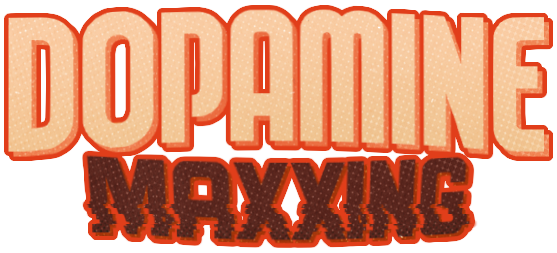

<p align="center">
  
</p>

<p align="center">
  <b>Landing oficial de DopaminemaXXing</b><br>
  Un incremental de mesa ambientado en un salón de juegos retro… dentro de una simulación.
</p>

<p align="center">
  <a href="https://tamara1001.itch.io/dopaminemaxxing"><b>▶ Jugar gratis en itch.io</b></a>
</p>

---

## Sobre el juego

**DopaminemaXXing** es un juego incremental para navegador hecho en Unity. Cuatro mesas corren a la vez y cada una paga en su propia moneda:

| Mesa | Qué hacés | Moneda |
|---|---|---|
| 🎯 Ruleta | Apostás del 1% de tu saldo a todo o nada | Fichas |
| 🎲 Casillero de dados | Tirás los dados y recorrés un tablero de casillas sorpresa | Billetes |
| 🎣 Pesca | Elegís carnada y caña, y reaccionás cuando pica | Doblones |
| ⚔️ Ejército de oleadas | Comprás y fusionás tropas que pelean solas | Oro |

Con lo que ganás mejorás cada mesa en su propio árbol y, al hacer prestigio, convertís tu progreso en **Dopamina** para el árbol global de mejoras permanentes.

## Sobre esta página

Landing estática con dirección de arte retro (folletos de computadoras de los 70, papel impreso, ephemera de casino):

- Intro animada con franjas y encendido de la computadora DMX-01
- Menú desplegable con forma de ticket térmico / registro de electroencefalograma
- Dados y ruleta interactivos
- Árbol de mejoras que crece como una red neuronal, con ejemplos de mejoras reales del juego
- Footer con íconos que caen con gravedad y se pueden agarrar y tirar
- Diseño adaptable a escritorio (1920×1080) y celular, con soporte para "reducir movimiento"

## Estructura

```
├── index.html   # La página completa: estilos, animaciones y lógica
├── assets/      # Imágenes, íconos y texturas
└── vendor/      # Preact + htm (renderizado liviano, sin build)
```

No hay proceso de build ni dependencias que instalar.

## Correrla localmente

Los navegadores bloquean los módulos de JavaScript si abrís `index.html` con doble clic, así que levantá un servidor local en la carpeta:

```bash
npx serve
# o
python -m http.server
```

Y entrá a la dirección que muestra la terminal.

## Deploy

El sitio está pensado para [Vercel](https://vercel.com): importá este repositorio como proyecto nuevo y deployá sin configuración adicional. Cada push a la rama principal publica una versión nueva.

## Créditos

Desarrollado por **Estudio Manteca Games**.
Juego publicado en itch.io por [Tamara1001](https://tamara1001.itch.io/dopaminemaxxing).
