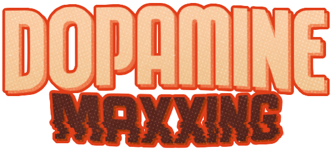

<p align="center">
  
</p>

<p align="center">
  <b>Landing oficial de DopaminemaXXing</b><br>
  Un incremental de mesa ambientado en un salón de juegos retro… dentro de una simulación.
</p>

<p align="center">
  <a href="https://tamara1001.itch.io/dopaminemaxxing"><b>▶ Jugar gratis en itch.io</b></a>
</p>

---

## Sobre el juego

**DopaminemaXXing** es un juego incremental para navegador hecho en Unity. Cuatro mesas corren a la vez y cada una paga en su propia moneda:

| Mesa | Qué hacés | Moneda |
|---|---|---|
| 🎯 Ruleta | Apostás del 1% de tu saldo a todo o nada | Fichas |
| 🎲 Casillero de dados | Tirás los dados y recorrés un tablero de casillas sorpresa | Billetes |
| 🎣 Pesca | Elegís carnada y caña, y reaccionás cuando pica | Doblones |
| ⚔️ Ejército de oleadas | Comprás y fusionás tropas que pelean solas | Oro |

Con lo que ganás mejorás cada mesa en su propio árbol y, al hacer prestigio, convertís tu progreso en **Dopamina** para el árbol global de mejoras permanentes.

## Sobre esta página

Landing estática con dirección de arte retro: toda la página se ve dentro de un televisor CRT.

- Arranque de la tele: pantallazo azul, terminal con el chequeo del sistema, encendido del tubo e intro de colores
- La imagen se curva como un tubo y se deforma al scrollear o arrastrar (curvatura, separación RGB, scanlines, ruido)
- Hero con el embudo arcoíris que entra en el logo y un diagrama de dopamina que se puede dibujar con el mouse
- Arrastrando el hero hacia un costado aparece el pitch conceptual (embebido desde Figma)
- Menú desplegable con forma de ticket térmico, colgado encima de la tele
- Dados y ruleta interactivos, monedas para juntar en los costados y luces del color de cada mesa
- Árbol de mejoras que crece como una red neuronal, con ejemplos de mejoras reales del juego
- Footer con íconos que caen con gravedad y se pueden agarrar y tirar
- Íconos del juego cayendo despacio en el fondo del hero y del pitch (decorativos)
- Sonidos sintetizados con Web Audio (arranque, botones, ticket, dados, ruleta, monedas, cambio de canal y scroll), con botón para silenciar
- Música ambiente en loop que entra con un fade in largo apenas aparece el hero (`assets/ambient-loop.wav`)
- Cursor pixelado retro (flecha y manito)
- Número de sesión real (contador compartido de [Abacus](https://abacus.jasoncameron.dev))
- Diseño adaptable a escritorio y celular, con soporte para "reducir movimiento"

## Estructura

```
├── index.html   # La página completa: estilos, animaciones y lógica (el televisor CRT va en el
│                #   primer <style> y en el <script> clásico; el sitio, en el componente Preact)
├── assets/      # Imágenes, íconos y texturas
└── vendor/      # Preact + htm (renderizado liviano, sin build)
```

No hay proceso de build ni dependencias que instalar.

## Correrla localmente

Los navegadores bloquean los módulos de JavaScript si abrís `index.html` con doble clic, así que levantá un servidor local en la carpeta:

```bash
npx serve
# o
python -m http.server
```

Y entrá a la dirección que muestra la terminal.
## Créditos

Desarrollado por **Estudio Manteca Games**.
Juego publicado en itch.io por [Tamara1001](https://tamara1001.itch.io/dopaminemaxxing).
